<a href="https://github.com/AG7-1">
  <picture>
    <source media="(prefers-color-scheme: dark)" srcset="dark_mode.svg">
    
  </picture>
</a>

  

  
  
  

### 🛠️ Stack

  

### 📌 Featured

| Project | What it is | Built with |
|---|---|---|
| [**WaveWall**](https://github.com/AG7-1/WaveWall) | Live Mac wallpaper that moves with your Spotify music: grainy gradients coloured by the track | Swift |
| [**demo-day-form**](https://github.com/AG7-1/demo-day-form) | Web form for demo day | TypeScript |

### 📈 Progress

<picture>
  <source media="(prefers-color-scheme: dark)" srcset="progress_dark.svg">
  
</picture>

### 🏎️ Garage

<picture>
  <source media="(prefers-color-scheme: dark)" srcset="car_dark.svg">
  
</picture>

<b>How this profile works</b>

Everything above is generated by Python in this repo and refreshed daily by GitHub Actions:
`generate.py` turns a photo into binary, `progress.py` builds the 3D contribution city,
and `car.py` raymarches a signed-distance-field supercar into 36 frames of 0s and 1s.

