  

  
  
  

### `> ls ./projects`

| | |
|---|---|
| [**WaveWall**](https://github.com/AG7-1/WaveWall) &nbsp;`Swift` | A live Mac wallpaper that moves with your Spotify music: grainy gradients coloured by the track. |
| _more shipping soon_ | |

### `> stack`

  

<code>> cat how_this_works.txt</code>

Every card is generated by Python in this repo and refreshed daily by GitHub Actions.
`generate.py` turns a photo into binary, `progress.py` lights up an LED matrix of the year,
and `car.py` renders a photo of an Aventador in amber 0s and 1s.

